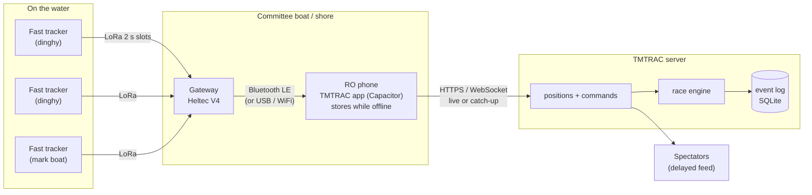

# TMTRAC fast tracking: plan (draft v0.5)

Two-second GPS tracking for dinghy racing over LoRa, for **TMTRAC** (tmtrac.my).

TMTRAC already exists: a race-management app with live spectator tracking, deployed on cPanel, using Meshtastic trackers. A rebuild is planned (`tmtrac/docs/REBUILD_PLAN.md`, new code in `feelgoodinc183/boat-race-tracker`). This document covers the part neither of those solves yet: **tracking 30 boats every 2 seconds**, which Meshtastic can't do.

Items marked **[DECIDE]** still need an answer.

---

## 0. Decisions so far

| Topic | Decision | Source |
|---|---|---|
| Product | TMTRAC, tmtrac.my | You |
| Region | Malaysia. Fast trackers use **919 to 923 MHz** only (see 3.2) | You + MCMC spec |
| Boards | Heltec V4 + 2× T-Echo, all 915 MHz versions | You |
| Boats | Dinghies, about 30 per race, 2 s updates | You |
| Venues | Mostly near shore with mobile data. Sometimes none, so recording must survive offline | You |
| Business model | Many clubs (multi-club comes back after v1 in the rebuild plan) | You + rebuild plan |
| Spectator feed delay | Yes, per event | You |
| Apps | Web first. Android app via **Capacitor** for race officers and skippers | Rebuild plan |
| Race logic | **Server owns the race**, server clock, append-only event log, pure rules engine | Rebuild plan |
| Hosting (v1) | cPanel (Exabytes) with Node 22 and built-in SQLite | Rebuild plan |
| Design | Meshtastic visual language + antislop rules, custom icons, no logo yet. See [DESIGN.md](DESIGN.md) | You |
| Race logic on devices | None, not even offline. The server's engine is the only one | You + rebuild plan |
| MCMC power limit | Test at Meshtastic `MY_919` limits; confirm the official rule before selling to clubs | You |
| Repos | Firmware, protocol and decoder here (public). App in `boat-race-tracker` (private) | You |
| License | MIT for this repo | You |

---

## 1. How this fits with TMTRAC

### What exists today
- **tmtrac** (live): React + Express app. Trackers are Meshtastic devices; positions arrive by a phone or laptop relaying a T-Echo over Bluetooth, or through the Meshtastic MQTT broker. Positions arrive about every 30 seconds or slower.
- **Rebuild plan**: smaller app, server owns the race, Capacitor Android app, cPanel Node 22. It lists "LoRa positions are slow (every 30 s or more)" as a risk, so GPS can only *suggest* starts and finishes.

### What this project adds
Trackers and a gateway that deliver every boat's position every 2 seconds, plus the code that hands those positions to the TMTRAC server. At 2 s, GPS start-line and finish suggestions become precise enough to be really useful to the race officer (taps by the RO are still the official record).

### Repo split (decided)

Why two repos:
- **Public vs. private.** `boat-tracker` is public; `boat-race-tracker` is private. Clubs need to download and flash firmware themselves, so firmware releases should be public. The app, billing and server code can stay private.
- **Different tools and release cycles.** Firmware is C++ built with PlatformIO and flashed onto devices; the app is TypeScript deployed to a server and the Play Store. Firmware versions on the water must keep working with newer apps, so they need their own versioned releases.
- **Narrow connection.** The only shared code is the packet decoder (about 100 lines plus test vectors). It's published from here as a small versioned package and used by the server.

The cost is one extra step when the packet format changes: release a new decoder version here, then update it in the app.

| Repo | Holds |
|---|---|
| **boat-tracker** (this one) | Tracker firmware, gateway firmware, radio protocol, packet decoder (TypeScript package), fleet simulator, hardware and setup guides |
| **boat-race-tracker** (rebuild) | Server, race engine, web app, Capacitor app. Adds "relay a TMTRAC gateway" next to its existing "relay a Bluetooth T-Echo" |

The two connect at one place: the `positions` message the rebuild plan already defines:

```
{ type: 'positions', trackerId, fixes: [{ lat, lng, speedKt, headingDeg, fixTime }] }
```

The gateway (through the phone) sends exactly that, so the server doesn't care whether a fix came from Meshtastic, a phone's GPS or a fast tracker.

I couldn't open `boat-race-tracker` (it's private and I don't have access to it from this session), so I've worked from the plan in the tmtrac repo. If the rebuild has moved on since, tell me what changed.

---

## 2. System overview



**Key change from v0.2:** the gateway connects to the race officer's phone over Bluetooth, and the phone sends positions to the server. That means:
- No 4G router or WiFi needed on the gateway. The RO phone already has mobile data near shore.
- **Offline works for free.** When there's no signal, the TMTRAC app keeps positions on the phone and uploads when signal returns. The gateway also keeps a copy in its own memory.
- The RO sees all boats on the map on the water even with no internet, because the app has the data locally.
- No MQTT broker, so cPanel hosting is enough for v1.
- Bandwidth is tiny: 30 boats × 20 bytes every 2 s is 300 bytes per second, well within Bluetooth LE.

The rebuild already plans native Bluetooth in the Capacitor app for T-Echos, so this reuses that work.

---

## 3. Radio and firmware

### 3.1 Why custom firmware

| Option | Problem for 30 dinghies at 2 s |
|---|---|
| Meshtastic (what tmtrac uses) | Built for chat and occasional positions. Mesh rebroadcasts multiply airtime. It can't schedule 30 boats every 2 s |
| LoRaWAN | Random transmit times cause collisions as the fleet grows. Needs a network server per club |
| **Custom LoRa with time slots (TDMA)** | Each boat sends in its own slot, timed by GPS. No collisions, fixed delay, one cheap gateway |

**Plan: custom TDMA firmware.** Meshtastic stays supported in TMTRAC for clubs that already use it (slow tracking, cruiser races, safety boats). A T-Echo can be flashed between the two.

### 3.2 Malaysia band rules
Meshtastic's firmware source (`src/mesh/RadioInterface.cpp`) summarises MCMC's *Short Range Devices Specification* (https://www.mcmc.gov.my/skmmgovmy/media/General/pdf/Short-Range-Devices-Specification.pdf) as:
- **919 to 923 MHz: 500 mW (27 dBm), no restrictions.**
- 923 to 924 MHz: 500 mW, but only with a 1% duty cycle or frequency hopping.

So:
- **Fast trackers use 919 to 923 MHz only.** Our TDMA has every tracker transmitting on a fixed frequency every 2 s, which wouldn't meet the 923 to 924 MHz conditions. 4 MHz still fits 16 channels of 250 kHz.
- Transmit power is capped at 27 dBm. The Heltec V4 high-power board can reach about 28 dBm, so firmware turns it down, minus any antenna gain above 0 dBi.
- **Before selling to clubs:** read the MCMC document itself to confirm whether 500 mW means transmitter output or EIRP (including antenna gain), and whether the devices need type approval (SIRIM) for commercial sale.

### 3.3 Radio settings and timing

| Setting | 20-byte packet | 24 bytes (with auth tag) | Slots in 2 s |
|---|---|---|---|
| SF7 / 125 kHz | 56.6 ms | about 61 ms | 26: **too few for 30 boats** |
| **SF7 / 250 kHz** | 28.3 ms | about 31 ms | **50 (40 ms slots)** |
| SF7 / 500 kHz | 14.1 ms | about 16 ms | 80+ |

**Plan: SF7 / 250 kHz, 40 ms slots, 2 s cycle.** Slot 0 is the gateway beacon, slots 1 to 45 are boats and mark boats, 46 to 49 spare. This matches Meshtastic's **ShortFast** preset, so the Phase H0 range test measures the real setting.

Fallback if range is too short: SF7 / 125 kHz with the fleet split across two channels and two gateway radios. The 919 to 923 MHz band also lets separate courses (e.g. Optimist and ILCA) each run on their own channel.

Confirmed from Meshtastic's firmware source (`src/mesh/MeshRadio.h`): ShortFast is SF7, 250 kHz, coding rate 4/5. (Some forum posts say 500 kHz; that's ShortTurbo.)

Slot timing relies on the GPS PPS pulse. **Verify in Phase H1** that PPS is wired on the T-Echo.

### 3.4 Draft position packet (20 bytes, +4 auth tag)

| Bytes | Field | Notes |
|---|---|---|
| 1 | version (3 bits) + type (5 bits) | position, status, mark, etc. |
| 2 | tracker ID | unique across TMTRAC |
| 1 | sequence number | loss stats |
| 2 | fix time | deciseconds mod 6553.6 s; full time rebuilt from receive time |
| 4 | latitude | int32, 1e-7 degrees |
| 4 | longitude | int32, 1e-7 degrees |
| 2 | SOG | 0.01 kn |
| 2 | COG | 0.01 degrees |
| 1 | battery | percent |
| 1 | flags | fix quality, low satellites, low battery, button pressed |
| (4) | auth tag | truncated AES-CMAC with a per-club key |

### 3.5 Slots and binding
- **MVP:** each tracker has a fixed slot set when flashed (a club's tracker #7 always uses slot 7). Binding to a boat stays a server-side record, using the rebuild's `bindTracker` command.
- **Later:** the gateway beacon assigns slots per race, so a club can own more than 45 trackers.

### 3.6 Hardware

| Board | Role | Notes |
|---|---|---|
| Heltec WiFi LoRa 32 V4 | **Gateway** | ESP32-S3: Bluetooth LE to the phone, WiFi as an alternative, high TX power for the beacon |
| LilyGO T-Echo | **Tracker (first candidate)** | nRF52840 low power, L76K GPS, 850 mAh. Case not waterproof |
| LilyGO T-Echo Card | Tracker candidate | Weatherproof + solar. Worth buying one to test |
| Heltec V4 + L76K + battery + box | Tracker candidate | Possibly cheaper, more assembly |

Dinghy concerns: trackers sit low (0.5 to 1 m) and go underwater in a capsize. Range depends most on the **gateway antenna height** (external antenna on a pole on the committee boat). Trackers need a sealed box or dry pouch, a lanyard, and a consistent mounting spot.

---

## 4. Working offline

| Situation | What happens |
|---|---|
| **Phone has signal** (most races) | Gateway → phone → server live. Spectators see the race with the event's delay |
| **Patchy** | The app queues positions and commands, uploads when signal returns. Server accepts late positions (they carry GPS time) and recalculates. Spectators see "catching up" |
| **No signal all day** | The RO phone shows boats on the map from local data and records the RO's commands (starts, recalls, finish taps) in a queue. No GPS start or finish suggestions until the phone reconnects. Everything uploads back on shore, the server runs the race, and it appears as a replay with suggestions. The gateway's own copy is the backup |

This follows the rebuild plan's offline rule: the device queues commands with unique IDs, the server ignores duplicates and rejects commands that no longer apply.

**Decided:** no race logic runs on a device, even offline. The phone only displays positions and queues commands. The cost: at venues with no signal, the RO works from taps alone during the race, which is how races are run without tracking today anyway.

---

## 5. Server changes needed in the rebuild

Small, because the rebuild's design already fits:
1. Accept `positions` batches of up to a few thousand fixes (catch-up after offline).
2. Dedupe by `(trackerId, fixTime)`, since a tracker may be heard by two gateways or uploaded twice.
3. Spectator feed delay per event, applied on the server so real-time positions never reach a public browser (Racing Rules of Sailing rule 41).
4. Tracker records gain `kind` (meshtastic, phone, fast), slot number and last battery.
5. Position storage sized for 2 s updates: 30 boats × 3 hours ≈ 160,000 rows per race. Fine for SQLite with an index on `(trackerId, fixTime)`.

### Hosting [DECIDE, later]
- **v1 on cPanel**, as the rebuild plan decided. With positions coming in through the phone, there's no MQTT broker to host.
- **Watch for:** Passenger stopping the app when idle (cold starts), WebSocket limits on shared hosting, and CPU limits on busy Saturdays with several clubs racing.
- **Oracle free tier** is the next step when multi-club launches or cPanel limits show up. The server should stay portable (plain Node + SQLite, settings via environment variables) so moving is a deploy, not a rewrite. If you use Oracle, upgrade the account to Pay As You Go so the idle VM isn't reclaimed, and choose Singapore as the home region.

---

## 6. Phases (hardware track)

These run alongside the rebuild's phases. **H** = hardware.

| Phase | Deliverable | Done when |
|---|---|---|
| **H0. Range test** (with your 3 boards, no code) | Step-by-step guide: [range-test-h0.md](range-test-h0.md). Can share a day with the rebuild's "Phase 0 test day" | `docs/phase0-results.md`: range at deck height vs. on a pole, loss when crew blocks or after capsize, T-Echo battery hours |
| **H1. Firmware MVP** | Tracker firmware (T-Echo), gateway firmware (Heltec V4) with flash buffer, TDMA slots, packet spec + test vectors, TypeScript decoder | 2 T-Echos at 2 s, under 2% loss, gateway survives power cycle without losing data |
| **H2. Simulator + bridge** | Fleet simulator (30 boats, offline gaps), gateway → Bluetooth protocol, decoder package ready for the Capacitor app | Simulated race reaches the rebuild server as `positions` batches |
| **H3. On-water test** | 2 T-Echos sailing with the gateway on the committee boat, relayed by a phone running the TMTRAC app | Tracks show on the live map with under 5 s delay, and survive a signal dropout |
| **H4. Small fleet** | 5 to 10 trackers, waterproof mounting, auth tags, a USB flashing page for club admins | A club admin flashes and binds a new tracker without help |
| **H5. Full event** | 30 boats | A full race day with no manual fixes |

To get to H4 you'd need about 3 to 8 more trackers (915 MHz), waterproof boxes or pouches, an external 915 MHz antenna and pole for the gateway, and a spare Heltec V4. Buy after H0 picks the tracker model.

---

## 7. Risks

| Risk | Mitigation |
|---|---|
| Range too short with low dinghy antennas | H0 measures it first. Raise the gateway antenna. Fallback: SF7 / 125 kHz on two channels |
| MCMC details (power measured how, type approval for sale) | Stay in 919 to 923 MHz at 27 dBm; read the MCMC specification before selling to clubs |
| PPS not wired, so slot timing is loose | Verify in H1. Fallback: wider slots timed from the gateway beacon |
| Phone's Bluetooth link drops (battery saver, app killed) | Gateway buffers to flash and resends. Android foreground service, as the rebuild already plans |
| Tracker underwater after capsize | Sealed box, lanyard, gaps shown honestly on the map |
| Spoofed positions | Per-club auth tag |
| cPanel limits at multi-club scale | Keep server portable; move to Oracle when needed |
| Rule 41 complaints | Server-side spectator delay |

---

## 8. Still open

1. **Is the rebuild plan in the tmtrac repo still current?** I can't read `boat-race-tracker` from here.
2. **Range test results** (Phase H0) decide the tracker model, the gateway antenna setup, and whether SF7 / 250 kHz holds up.
