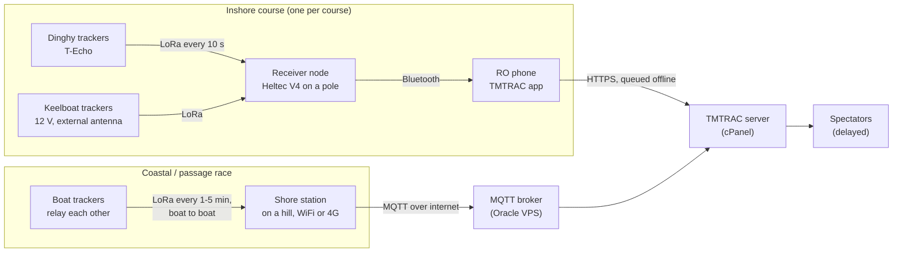

# TMTRAC tracking: plan (draft v0.7)

How boats get tracked for **TMTRAC** (tmtrac.my): inshore races with dinghies and keelboats, and coastal or passage races, for clubs across Malaysia.

TMTRAC is the race-management app (live in the `tmtrac` repo; the rebuild is going into `feelgoodinc183/boat-race-tracker`). This repo covers the **tracking side**: which hardware, how it's set up, how it's tested, and an optional faster radio protocol for later.

**Big change from v0.6:** trackers run **stock Meshtastic** at launch instead of custom firmware. Custom firmware only gave one thing Meshtastic can't (2-second updates for inshore starts), at the cost of weeks of firmware work and no relaying between boats for coastal races. See section 3.

Items marked **[DECIDE]** still need an answer.

---

## 0. Decisions so far

| Topic | Decision | Source |
|---|---|---|
| Product | TMTRAC, tmtrac.my | You |
| Boats | Dinghies **and** keelboats, mixed classes | You |
| Race types | Inshore buoy races **and** coastal / passage races | You |
| Size | 30 to 50 boats at the biggest regattas, on 2 to 3 courses | You |
| Trackers at launch | **Stock Meshtastic**, set up with racing profiles ([meshtastic-setup.md](meshtastic-setup.md)) | This plan |
| Custom fast firmware | Optional later, only for inshore start-line calls. Protocol already specified in [protocol/](../protocol/) | This plan |
| Region | Malaysia. Use **919 to 923 MHz** only (see 4.1) | MCMC spec |
| Boards on hand | Heltec V4 + 2× T-Echo, all 915 MHz versions | You |
| Venues | Mostly near shore with mobile data; sometimes none | You |
| Business model | Many clubs (multi-club comes back after v1 in the rebuild plan) | You + rebuild plan |
| Spectator feed delay | Yes, per event | You |
| Apps | Web first. Android app via Capacitor for race officers and skippers | Rebuild plan |
| Race logic | Server owns the race; none on devices, even offline | You + rebuild plan |
| Hosting | cPanel for the app (v1). Oracle free tier VPS for the MQTT broker (section 6) | Rebuild plan + this plan |
| Design | Meshtastic look + antislop rules, custom icons, no logo yet ([DESIGN.md](DESIGN.md)) | You |
| Repos | This one public (MIT): tracking guides, tools, protocol. App private in `boat-race-tracker` | You |

---

## 1. How positions reach TMTRAC

tmtrac already reads Meshtastic in two ways: a phone relaying a Meshtastic node over Bluetooth, and an MQTT bridge. The plan uses both, one per race type.

**Inshore:** each course has its own frequency and a receiver node on its committee boat, connected by Bluetooth to the race officer's phone. The phone uploads positions, and keeps them while there's no signal (the rebuild already plans this).

**Coastal and passage:** boats spread out over tens of km, so trackers relay each other's positions (Meshtastic's mesh) toward shore stations on high ground. Shore stations forward to an MQTT broker, and tmtrac's existing bridge reads them.

**Out of LoRa range entirely** (far offshore, no shore station in reach): Meshtastic doesn't store positions for later, so these show as gaps. Backups: skippers' phones sharing GPS where there's mobile data (already in the rebuild plan), or satellite trackers for genuinely offshore events. Out of scope for now.

---

## 2. Update rates and capacity

A Meshtastic position packet with speed, heading, time and sequence number takes roughly 50 ms on air at ShortFast (estimate; the M0 test measures it). Meshtastic "Tracker" devices stop sending when the channel is more than 40% busy, and above roughly 20% busy, collisions start costing a noticeable share of packets.

| Situation | Boats on one frequency | Interval | Channel busy | Verdict |
|---|---|---|---|---|
| One inshore course | 15 to 25 | 10 s | 8 to 13% | Good |
| One inshore course, large | 30 | 10 s | 15% | Good |
| Whole regatta on one frequency | 50 | 10 s | 25% | Avoid: losses climb. Use one frequency per course |
| Whole regatta on one frequency | 50 | 15 s | 17% | Workable fallback |
| Coastal race | 50 | 2 min, with up to 3 relays | about 6% | Good |
| Any inshore course | 30 | 2 s | 75% | Not possible on Meshtastic |

**Plan:** one frequency per course, 10-second updates inshore, 1 to 5 minutes for coastal and passage races.

What 10 s means for each feature:

| Feature | At 10 s | Notes |
|---|---|---|
| Spectator map | Smooth if the app animates between fixes | Spectators watch minutes behind anyway |
| Rankings, mark roundings | Fine | |
| Finish time suggestions | Within a few seconds by interpolation | RO taps stay the record |
| **Start line (over early)** | **Not possible**: boats move 25 to 40 m between fixes | The one real gap. See section 3 |
| Coaching replays | Coarse | Tacks visible, fine detail lost |

---

## 3. Custom fast firmware: later, if clubs want it

The custom protocol in [protocol/](../protocol/) (26-byte encrypted packets in fixed 2-second time slots, C and TypeScript code, tested) stays in the repo. It only matters for **GPS start-line calls** and detailed coaching replays on inshore courses.

**When to build it:** after the first real regattas on Meshtastic, if clubs ask for GPS over-early calls, or if Meshtastic loses too many packets inshore. Cost: tracker and gateway firmware (several weeks), plus on-water testing. Inshore boats could carry a fast tracker while coastal races stay on Meshtastic, since a T-Echo can be flashed either way.

---

## 4. Radio

### 4.1 Malaysia band rules
Meshtastic's firmware source summarises MCMC's *Short Range Devices Specification* (https://www.mcmc.gov.my/skmmgovmy/media/General/pdf/Short-Range-Devices-Specification.pdf):
- **919 to 923 MHz: 500 mW (27 dBm), no restrictions.**
- 923 to 924 MHz: 500 mW only with a 1% duty cycle or frequency hopping.

Meshtastic's `MY_919` region covers 919 to 924 MHz, so **set the frequency explicitly** to stay inside 919 to 923.

**Before selling to clubs:** read the MCMC document itself to confirm whether 500 mW means transmitter output or EIRP (including antenna gain), and whether devices sold commercially need SIRIM type approval.

### 4.2 Frequencies

All on the ShortFast preset (SF7, 250 kHz). Spaced 1 MHz apart so a strong nearby transmitter on one course doesn't bleed into another:

| Use | Frequency |
|---|---|
| Course A | 919.875 MHz |
| Course B | 920.875 MHz |
| Course C | 921.875 MHz |
| Coastal / passage races | 922.625 MHz |

[DECIDE, later] whether clubs at different venues share these or get their own. Clubs far apart can reuse them.

### 4.3 Security and fairness
- Every event gets its **own private channel with a random 256-bit key**. Meshtastic encrypts positions with it, so nobody nearby can read live positions and get around the spectator delay (Racing Rules of Sailing rule 41).
- Channel position precision is set to full; the key and channel are kept by the TMTRAC server and never sent to spectators' browsers (tmtrac already does this).
- The spectator delay is applied on the server.

---

## 5. Hardware

| Role | Hardware | Notes |
|---|---|---|
| Dinghy tracker | LilyGO T-Echo (or T-Echo Card, weatherproof) | Dry pouch or sealed box, lanyard, mounted the same place on every boat |
| Keelboat tracker | Any Meshtastic board with GPS, powered from the boat's 12 V, external antenna on the pushpit | Higher antenna and no battery limit: much better range. Stays on the boat for the season |
| Committee boat receiver | Heltec V4 with an external antenna on a pole, powered by a power bank or 12 V | One per course. Bluetooth to the RO phone |
| Shore station (coastal races) | Meshtastic board on a mast on high ground, mains or solar, WiFi or 4G | Placed so the race route stays in range. Coverage decides where |

---

## 6. Hosting

- **TMTRAC app: cPanel (Node 22)**, as the rebuild plan decided.
- **MQTT broker: Oracle free tier VPS** running Mosquitto. Shared cPanel hosting can't run a broker. Using our own broker rather than the public Meshtastic one gives control over uptime and who can connect, and keeps race traffic off a shared service. tmtrac's bridge already supports approved broker hosts.
- Oracle setup notes: choose Singapore as the home region (it can't be changed later), and upgrade the account to Pay As You Go so the always-free VM isn't reclaimed for being idle between races.

---

## 7. What the rebuild app needs

1. Accept Meshtastic positions from both the Bluetooth relay and the MQTT bridge (both exist in tmtrac today).
2. Dedupe by tracker and fix time: a position can arrive through two receivers or both paths.
3. Event setup: per-course frequency and channel key, so the app can show which receiver belongs to which course.
4. Spectator delay per event, applied on the server.
5. Animate boats between fixes on the map.
6. Later: one-tap "apply racing profile" from the TMTRAC app to a tracker over Bluetooth, so club admins don't set 15 Meshtastic settings by hand.

---

## 8. Phases

| Phase | Deliverable | Done when |
|---|---|---|
| **M0. Range and rate test** (your 3 boards) | Guide: [range-test.md](range-test.md), now with a second session for 10-second Tracker mode | `docs/phase0-results.md`: range at deck height vs. pole, loss at 10 s, crew blocking and capsize, battery hours, Meshtastic's reported channel use |
| **M1. Racing profiles** | [meshtastic-setup.md](meshtastic-setup.md): settings for every role and race type (**draft done**) | Profiles confirmed by the M0 results |
| **M2. One inshore course** | As many trackers as available, one receiver, RO phone with the TMTRAC app | Live positions on the map with fewer than 5% missing, through a full race |
| **M3. Coastal setup** | One shore station, Mosquitto on Oracle, tmtrac bridge connected | Positions from a coastal race arrive through boat-to-boat relays |
| **M4. Full regatta** | 30 to 50 boats, 2 to 3 courses | A regatta day with no manual fixes |
| Later: fast mode | Custom firmware using [protocol/](../protocol/) | Only if clubs want GPS start-line calls |

---

## 9. Risks

| Risk | Mitigation |
|---|---|
| Dinghy range too short (low antennas, capsizes) | M0 measures it. Raise the receiver antenna |
| Collisions at 10 s with large fleets | One frequency per course; 15 s fallback; Tracker role keeps sending until the channel is 40% busy |
| Coastal fleet goes out of range of every shore station | Plan shore station sites along the route; phones as backup; gaps shown honestly |
| Meshtastic changes settings or behaviour between versions | Pin a tested firmware version in the setup guide; re-test before upgrading club trackers |
| MCMC details (power measurement, type approval for sale) | Stay in 919 to 923 MHz at 27 dBm; read the specification before selling |
| Live positions intercepted | Private channel with a random 256-bit key per event |
| Rule 41 complaints | Server-side spectator delay |
| No start-line calls at 10 s | RO taps are the record, as today. Fast mode later if clubs want it |

---

## 10. Still open

1. **Is the rebuild plan in the tmtrac repo still current?** I can't read `boat-race-tracker` from here.
2. **MQTT broker on the Oracle VPS:** OK to set up for coastal races (phase M3)?
3. **Shore station sites** for the coastal routes you race most. Needed before M3.
