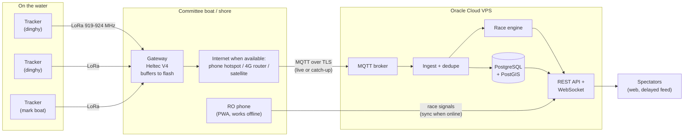
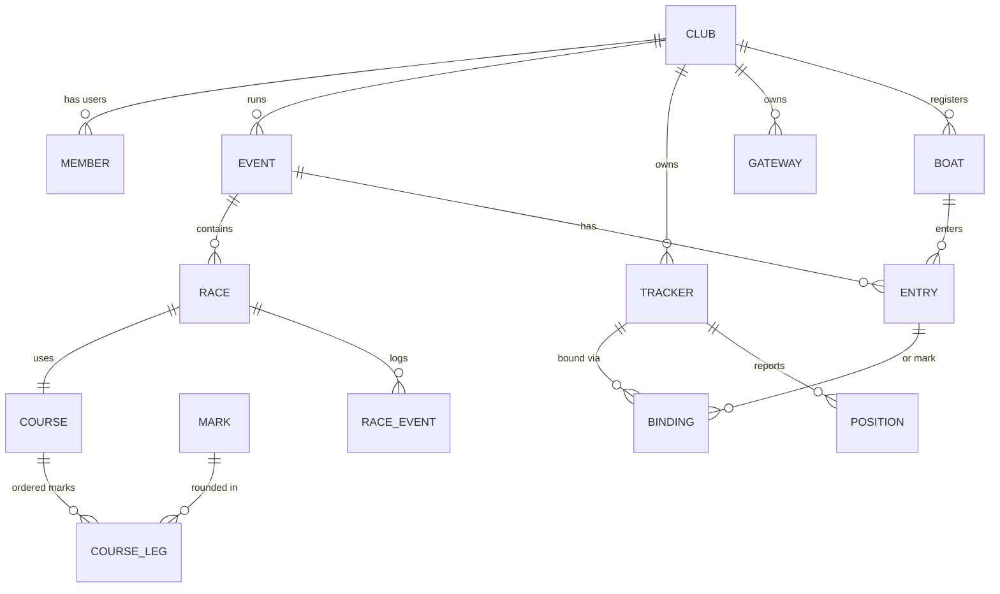

# Boat Tracker: Project Plan (draft v0.2)

Live GPS tracking for dinghy racing over LoRa, run as a service for many sailing clubs. A race officer (RO) sets up a course, binds trackers to boats, and runs the race. Spectators follow it live on the web, with a configurable delay, and can replay it afterwards.

This document is a plan, not a spec. Items marked **[DECIDE]** still need an answer.

---

## 0. Decisions so far

| Topic | Decision |
|---|---|
| Region | Malaysia, 919 to 924 MHz band |
| Boats | Dinghies, about 30 per race |
| Update rate | Every 2 seconds |
| Venues | Sometimes far offshore with no mobile data. The system must work offline and catch up later |
| Business model | Multi-club service (multi-tenant) |
| Hosting | Oracle Cloud free tier VPS for the app. cPanel hosting for the domain, email and backups |
| Spectator feed delay | Yes, configurable per event |
| Apps at launch | Web apps (PWA). Native apps later |
| Hardware on hand | 1× Heltec WiFi LoRa 32 V4, 2× LilyGO T-Echo |

---

## 1. Goals and non-goals

**Goals**
- Track up to 45 devices per race (30 boats + mark boats + spares) at a 2 second update, under 5 seconds from GPS fix to RO screen when online.
- Work 2 to 5 km from a receiver on open water, with trackers mounted low on dinghies.
- Keep recording when there's no internet. Upload when the connection comes back, and rebuild the race from the late data.
- Let several clubs run their own events, trackers, boats and ROs on one service.
- Spectators watch with no login, on desktop and mobile, live (delayed) or as replay.
- Off-the-shelf boards a club can buy and flash itself.

**Non-goals (for now)**
- Official scoring or official OCS calls. Consumer GPS is accurate to 2 to 3 m, so start data is shown as *indicative*.
- Phones as trackers.
- Mesh networking between boats.
- Native mobile apps (until after the web apps prove out).

---

## 2. System overview

Monorepo parts:

| Part | What it does | Proposed tech |
|---|---|---|
| `firmware/tracker` | Reads GPS, packs a position packet, sends it in its time slot | PlatformIO, Arduino framework, RadioLib, TinyGPS++ |
| `firmware/gateway` | Receives LoRa, adds signal info and receive time, forwards to the server, buffers to flash when offline, sends a sync beacon | PlatformIO on Heltec V4 (ESP32-S3, WiFi) |
| `protocol` | Packet spec, C encoder, TypeScript decoder, shared test vectors | C header + TS package |
| `race-core` | Course geometry, mark rounding, rankings. Shared TypeScript so it runs on the server **and** in the browser (needed for offline use) | TypeScript package |
| `server` | Ingest, storage, race engine, API, live fan-out, multi-club accounts | Node.js + TypeScript, Fastify, PostgreSQL + PostGIS, Mosquitto |
| `web` | RO console + spectator viewer, installable as a PWA | React + Vite, MapLibre GL JS, OpenSeaMap seamark overlay |
| `tools/simulator` | Fake 30-boat fleet that sails a course and publishes packets like a real gateway, including offline gaps | TypeScript |
| `infra` | Docker Compose for the VPS, backups, TLS | Docker Compose, Caddy |

---

## 3. Radio and firmware

### 3.1 Why custom firmware

| Option | Problem for 30 dinghies at 2 s |
|---|---|
| Meshtastic | Built for chat and occasional positions. Mesh rebroadcasts multiply airtime, and it can't schedule 30 boats every 2 s |
| LoRaWAN | Devices transmit at random times, so packets collide as the fleet grows, and it needs network server setup per club |
| **Custom LoRa with time slots (TDMA)** | Each boat sends in its own slot, timed by GPS. No collisions, predictable delay, one cheap gateway |

**Decision: custom TDMA firmware.** Meshtastic is still useful for the Phase 0 range test, because its "ShortFast" preset uses the same radio settings we plan to use.

### 3.2 Malaysia band rules

- Meshtastic's `MY_919` region profile uses 919.0 to 924.0 MHz, a 27 dBm power cap and no duty cycle limit.
- **To confirm:** the current MCMC class assignment text for 919 to 924 MHz (maximum power, and whether the limit is transmit power or EIRP including antenna gain). I couldn't find the official text online.
- The Heltec V4 high-power version can transmit at about 28 dBm. Firmware caps it to stay within the legal limit, accounting for antenna gain.
- **Check your boards:** T-Echo and Heltec come in 433, 868 and 915 MHz versions. Malaysia needs the **915 MHz version** (it covers 919 to 924). The label on the box or board says which one you have.

### 3.3 Radio settings and timing budget

Time on air per packet (CR 4/5, preamble 8, CRC on):

| Setting | 20 bytes | 24 bytes (with auth tag) | Slots in 2 s (with guard time) |
|---|---|---|---|
| SF7 / 125 kHz | 56.6 ms | about 61 ms | 26 (75 ms slots): **too few for 30 boats** |
| **SF7 / 250 kHz** | 28.3 ms | about 31 ms | **50 (40 ms slots)** |
| SF7 / 500 kHz | 14.1 ms | about 16 ms | 80+ |

**Plan: SF7 / 250 kHz, 40 ms slots, 2 s cycle.**
- Slot 0: gateway beacon. Slots 1 to 45: boats and mark boats. Slots 46 to 49: spare.
- This is the same as Meshtastic's ShortFast preset, so Phase 0 measures the real range of the setting we'll ship.
- 250 kHz loses about 3 dB of range compared with 125 kHz. If Phase 0 shows range is too short, the fallback is SF7 / 125 kHz with the fleet split across two channels (two gateway radios).
- The 5 MHz band fits many 250 kHz channels. Separate fleets or courses (e.g. Optimist and ILCA courses at the same regatta, or two clubs nearby) each get their own channel and gateway.

Slots need accurate time on each tracker. GPS PPS (pulse per second) gives microsecond accuracy. **To verify in Phase 1:** that the PPS pin is wired on the T-Echo, and on the GPS module we'd use with the Heltec V4.

### 3.4 Draft position packet (20 bytes, +4 for auth tag)

| Bytes | Field | Notes |
|---|---|---|
| 1 | version (3 bits) + type (5 bits) | position, status, mark, etc. |
| 2 | tracker ID | unique across the whole service |
| 1 | sequence number | loss stats |
| 2 | fix time | deciseconds mod 6553.6 s. Server rebuilds the full timestamp (gateway also records receive time) |
| 4 | latitude | int32, 1e-7 degrees |
| 4 | longitude | int32, 1e-7 degrees |
| 2 | SOG | 0.01 kn |
| 2 | COG | 0.01 degrees |
| 1 | battery | percent |
| 1 | flags | fix quality, low satellites, low battery, button pressed |
| (4) | auth tag | truncated AES-CMAC with a per-club key. Stops fake positions at public events |

### 3.5 Slot assignment and binding

- **MVP:** each tracker has a fixed slot set when it's flashed (a club's tracker #7 always uses slot 7). A club's pool is limited to 45 trackers per channel. Binding a tracker to a boat is then only a server record, with no radio downlink.
- **Later:** the gateway beacon assigns slots per race, so pools can be larger than 45.

### 3.6 Hardware for dinghies

| Board | Role | Notes |
|---|---|---|
| Heltec WiFi LoRa 32 V4 | **Gateway** | WiFi to reach the internet, high transmit power for the beacon. No GPS onboard (an 8-pin header takes an external module) |
| LilyGO T-Echo | **Tracker (first candidate)** | nRF52840 low power, L76K GPS built in, 850 mAh battery. Case is not waterproof |
| LilyGO T-Echo Card | Tracker candidate | Weatherproof + solar. Worth buying one to test |
| Heltec V4 + L76K GPS + battery + box | Tracker candidate | Possibly cheaper per unit, more assembly, more power draw |

Dinghy-specific concerns:
- **Low antenna.** A tracker sits 0.5 to 1 m above water, often behind the crew or sail. Range depends mostly on the **gateway's height**: an external antenna on a 5 m+ pole on the committee boat or shore makes the biggest difference.
- **Capsizes.** The tracker goes underwater, so it must be sealed (IP67 box or dry pouch), tied on with a lanyard, and handle position gaps.
- **Mounting.** Same place on every boat (e.g. aft deck or the base of the mast), antenna vertical, clear of the crew.
- **Battery.** Target a full race day (8 hours) with margin. Measure in Phase 0.

Unit choice (T-Echo vs. Card vs. Heltec build) is decided after Phase 0, based on range, waterproofing and price for 30+ units per club.

---

## 4. Working offline

Some venues have no mobile data, so the system records first and uploads when it can.

### 4.1 Venue kit
- Gateway (Heltec V4) with an external antenna on a pole.
- RO phone running the RO web app (installed as a PWA, works offline).
- Optional internet link: phone hotspot, 4G router with an external antenna mounted high (usually reaches further offshore than a phone), or a satellite terminal.

### 4.2 Three situations

| Situation | What happens |
|---|---|
| **Online** | Gateway sends packets to the server live. Spectators see the race with the event's delay |
| **Patchy** | Gateway saves every packet to flash and sends the backlog, oldest first, when the link returns. The server accepts late packets (positions carry their own GPS time) and recalculates the race. Spectators see "catching up" |
| **No internet all day** | Gateway records the whole day (about 6 MB for 30 boats over 4 hours). The RO phone records race signals (start, recalls, finishes) with GPS-synced times. Both upload back on shore, and the race appears as a replay |

### 4.3 RO view on the water without internet [DECIDE, later phase]
The RO will want to see boats on a map even offline. Options:
1. **Gateway serves a small local page** over its own WiFi network: boat dots relative to the marks, online/battery list. No extra hardware. Limited by what fits on the ESP32.
2. **Venue box**: a Raspberry Pi or laptop running the same server software locally, gateway plugged in by USB. Full features offline, syncs to the cloud later. More kit to carry.

Option 1 first. The shared `race-core` package means rankings work in the browser either way.

### 4.4 Live spectators from a venue with no coverage
That needs some internet link from the venue. After Phase 0 we'll know your venues better and pick one: a 4G router with a high-mounted antenna, a satellite terminal, or a LoRa relay hop to a shore station that has coverage.

---

## 5. Server

### 5.1 Ingest
1. Gateway publishes to MQTT `gw/{gatewayId}/up` (live) or `gw/{gatewayId}/backlog` (catch-up), with signal strength and receive time.
2. Ingest decodes, rebuilds the full timestamp, and dedupes by `(trackerId, fixTime)` because several gateways may hear the same packet.
3. Drops impossible fixes (speed jumps beyond a dinghy's limit, no GPS fix).
4. Stores the fix and hands it to the race engine. Late fixes trigger a recalculation of the affected race.

### 5.2 Data model (multi-club)

- **Club**: every record belongs to a club (tenant). Club page at `/c/{club-slug}`.
- **Member**: user + club + role (club admin, race officer). One person can belong to several clubs.
- **Tracker / Gateway**: owned by a club, with hardware ID, firmware version, slot, last battery, last seen. Trackers can be lent to another club's event (binding records which event).
- **Event, Race, Entry, Boat**: as before. Race status: planned, in sequence, racing, finished, abandoned.
- **Binding**: tracker ↔ entry or ↔ mark, with valid-from and valid-to times, so replays always show the right boat.
- **Course leg**: ordered marks with rounding side, or gates/lines made of two marks. Courses can be saved as club templates.
- **Position**: partitioned by time in PostgreSQL.
- **Race event**: start, recalls, finish, retirement, RO notes. Each event records whether it was entered live or synced later.

### 5.3 Race engine (`race-core`)
- **Mark rounding**: boat crosses the line through the mark, perpendicular to the bisector of the two legs, within a radius.
- **Ranking**: distance to finish along the course. On upwind and downwind legs, measured along the wind axis when the RO enters a wind direction.
- **Start and finish**: line crossing, start marked indicative.
- Runs the same way live or when rebuilding a race from late data.

### 5.4 Feed delay
- RO and club admins see real time. Spectators see the feed delayed by the event's setting (e.g. 0, 2, 5 or 10 minutes), applied on the server, so the real-time data never reaches a public browser.
- Reason: Racing Rules of Sailing rule 41 (outside help). Replays have no delay once the race is finished.

### 5.5 Auth
- Club members log in (email + password, or email magic link).
- Spectators: no login. Events are public, unlisted (link only) or private.
- Each gateway has its own MQTT username/password, issued from the club's admin page.
- Each club has a key used for packet auth tags, loaded onto its trackers at flash time.

---

## 6. Hosting

| Where | What runs there | Why |
|---|---|---|
| **Oracle Cloud free tier** (Ampere ARM VM) | Docker Compose: Caddy (HTTPS), Node server, PostgreSQL + PostGIS, Mosquitto MQTT. Also serves the built web app | Needs long-running processes, WebSockets and an MQTT port (8883). Shared cPanel hosting can't do these reliably |
| **cPanel hosting** | Domain DNS, email, a simple info page if wanted, and a destination for nightly database backups | Uses what you already pay for |

Setup notes for Oracle:
- Pick the home region carefully at sign-up (it can't be changed later). Singapore is the usual nearest choice for Malaysia.
- Oracle may stop always-free instances it considers idle (low CPU, network and memory over 7 days). Our server will be quiet between races, so the safe fix is to **upgrade the account to Pay As You Go**: free-tier resources stay free, and idle instances are no longer reclaimed. It needs a card on file. Set a budget alert at a small amount.
- Free-tier ARM capacity is sometimes "out of capacity" in a region. If so, retry or use a smaller shape first.
- Backups: nightly `pg_dump`, kept on the VPS and copied to the cPanel host (and/or Oracle Object Storage).

Domains (example): `app.yourdomain.com` (web + API), `mqtt.yourdomain.com` (gateways).

---

## 7. Web apps

### 7.1 RO console
- Club admin: members, boats (manual or CSV import), trackers, gateways.
- Events and races. Course builder on a map: tap to drop marks or "use tracker X" for a mark boat, set order, rounding sides, start and finish lines, save templates.
- **Binding**: pick a boat, scan the QR code on the tracker with the phone camera (works in mobile browsers, including iPhone), or pick from trackers heard in the last minute.
- **Pre-start check**: which bound trackers are online, battery, last fix, which are missing.
- **Race control**: start sequence timer, start, recalls, finish, abandon, wind direction. Works offline and syncs later.
- Tracker setup (ID, slot, club key, region) happens by USB at the club using a flashing page in desktop Chrome (Web Serial). Bluetooth setup comes with the native app later, because iPhone browsers don't support Web Bluetooth.

### 7.2 Spectator viewer
- Club and event pages, list of live and past races.
- Live map: boats, trails, course, lines. Leaderboard by position on course, leg, gap to leader, speed.
- Tap a boat for details, follow a boat, filter by class.
- Replay with time slider and speed control.
- Clear states for: not started, no data yet, delayed feed, catching up, connection lost.

Design direction still needed (see section 10).

---

## 8. Phases

| Phase | Deliverable | Done when |
|---|---|---|
| **0. Range test (now, with your 3 boards)** | Meshtastic on all three, region `MY_919`, preset ShortFast (SF7/250 kHz, our planned setting). Range Test module: T-Echo on a dinghy sends, Heltec V4 on the committee boat or shore receives and logs | Results written to `docs/phase0-results.md`: max reliable range at deck height vs. on a pole, loss while crew blocks or after a capsize, T-Echo battery hours with GPS on |
| **1. Protocol + firmware MVP** | Tracker firmware (T-Echo first), gateway firmware with flash buffering, TDMA slots, packet spec + test vectors | 2 T-Echos + simulated slots, under 2% loss, gateway survives a power cycle without losing buffered data |
| **2. Server + simulator** (parallel with 1) | Oracle VPS set up, Docker Compose, MQTT ingest, DB schema with clubs, 30-boat simulator with offline gaps | Simulated race lands in the DB, live and as late catch-up, deduped |
| **3. Spectator map (basic)** | Live map, trails, delayed feed, replay | A real on-water test shown in a browser |
| **4. RO console** | Clubs, boats, trackers, courses, QR binding, race control (offline-capable) | An RO runs a race end to end without touching the database |
| **5. Race engine** | Mark roundings, rankings, start/finish, recalculation from late data | Rankings match what the RO saw on the water |
| **6. Club onboarding** | Club sign-up, member invites, gateway credentials, tracker flashing page | A second club sets itself up without our help |
| **7. Hardening + venue mode** | Auth tags, gateway local page for offline RO view, monitoring, low-battery alerts, multi-gateway | A full regatta day without manual fixes |
| **8. Native apps** | Expo app with Bluetooth tracker setup | In TestFlight / Play internal testing |

To start Phase 1 with 5 trackers you'd need roughly: 3 more trackers (915 MHz versions), waterproof boxes or dry pouches, an external 915 MHz antenna + pole for the gateway, and a spare Heltec V4. Buy after Phase 0 picks the tracker model.

---

## 9. Risks

| Risk | Mitigation |
|---|---|
| Range too short with low dinghy antennas | Phase 0 measures it first. Raise the gateway antenna. Fall back to SF7/125 kHz on two channels |
| Wrong frequency version of the boards | Check labels before Phase 0 |
| Unclear MCMC power limit | Confirm the class assignment text, cap firmware power to match |
| No internet at venue | Store and forward on gateway and RO phone. Server rebuilds races from late data |
| PPS not wired, so slot timing is loose | Verify in Phase 1. Fall back to wider slots timed from the gateway beacon |
| Tracker underwater after a capsize | Sealed box, lanyard, gaps shown honestly on the map |
| Oracle reclaims the idle free VM | Upgrade to Pay As You Go, nightly off-site backups |
| Spoofed positions | Per-club auth tag on packets |
| Rule 41 complaints | Server-side spectator delay |

---

## 10. Still open

1. **Board frequency versions**: are your Heltec V4 and T-Echos the 915 MHz versions?
2. **MCMC rules**: do you have the current class assignment text, or a local contact who knows the 919 to 924 MHz power limit?
3. **Venues**: typical distance offshore, and do committee boats have a mast or pole for an antenna?
4. **Name and domain** for the service.
5. **Design direction** for the web apps: look, mood, colours, any club branding. Also whether to apply the `antislop` design rules *during* the build or as an *audit after*.
