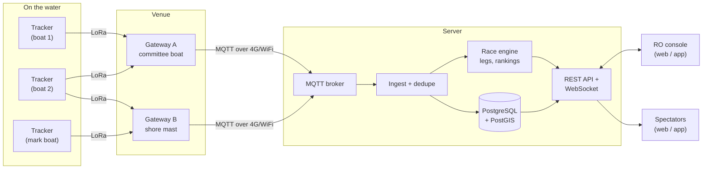
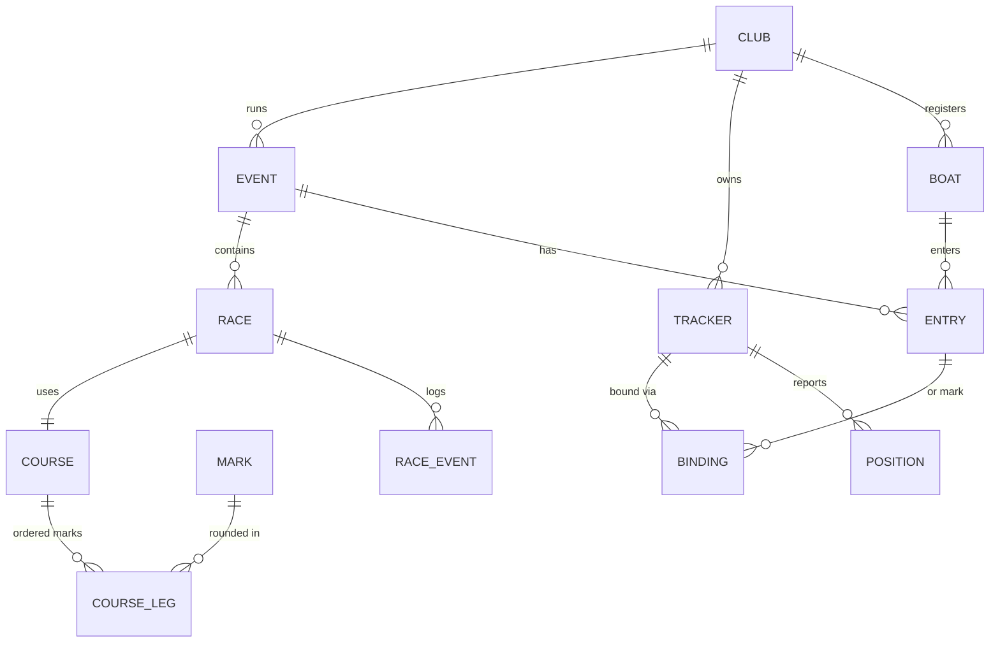

# Boat Tracker: Project Plan (draft v0.1)

Live GPS tracking for sailboat racing over LoRa. A race officer (RO) sets up a course, binds trackers to boats, and runs the race. Spectators follow it live on the web or in an app, and can replay it afterwards.

This document is a plan, not a spec. Items marked **[DECIDE]** need an answer before the matching phase starts. See the questions at the end.

---

## 1. Goals and non-goals

**Goals**
- Track 10 to 60 boats per race at 1 to 5 second update intervals, with under 5 seconds from GPS fix to spectator screen.
- Work on open water 2 to 5 km from a receiver, without depending on phone coverage on the boats.
- Let the RO do everything from a phone or laptop: create the event, build the course, bind trackers, start and finish the race.
- Spectators can watch live, with no login, on desktop and mobile. Replay works after the race.
- Hardware: off-the-shelf boards (Heltec WiFi LoRa 32 V4, LilyGO T-Echo and similar), so a club can buy and flash them itself.

**Non-goals (for now)**
- Official scoring or official OCS (on course side) calls. Consumer GNSS is accurate to about 2 to 3 m, and that's not good enough to rule on a start line. The system will show *indicative* start and finish data and say so.
- Phone-as-tracker. We may add it later as a fallback, but LoRa hardware is the core.
- Mesh networking between boats (see section 3.1).

---

## 2. System overview



Five parts, each its own folder in a monorepo:

| Part | What it does | Proposed tech |
|---|---|---|
| `firmware/tracker` | Reads GNSS, packs a position packet, sends it in its time slot | PlatformIO, Arduino framework, RadioLib, TinyGPS++ |
| `firmware/gateway` | Receives LoRa packets, adds RSSI/SNR and receive time, forwards to server, buffers when offline, sends a sync beacon | PlatformIO on Heltec V4 (ESP32-S3, WiFi). Later: Raspberry Pi + SX1302 multi-channel concentrator |
| `protocol` | Packet format spec, C encoder, TypeScript decoder, shared test vectors | C header + TS package |
| `server` | Ingest, storage, race engine, API, live fan-out | Node.js + TypeScript, Fastify, PostgreSQL + PostGIS, Mosquitto (MQTT), WebSocket |
| `web` | RO console + spectator viewer | React + Vite, MapLibre GL JS, OpenSeaMap seamark overlay |
| `mobile` | RO app (needs Bluetooth for tracker setup) + spectator app | Expo (React Native), MapLibre React Native, react-native-ble-plx |
| `tools/simulator` | Fake fleet that sails a course and publishes packets like a real gateway | TypeScript |

Why TypeScript end to end: one language for server, web and app, so the packet decoder, data types and race geometry are written once and shared.

The simulator is not optional. It lets us build and test the server and UI without boats on the water, and it gives repeatable races for testing rankings.

---

## 3. Radio and firmware

### 3.1 Why custom firmware, not Meshtastic or LoRaWAN

We looked at three options:

| Option | Good | Problem for racing |
|---|---|---|
| **Meshtastic** | Runs on both boards today, zero firmware work | Built for chat and occasional positions. Mesh rebroadcasts multiply airtime, and position intervals are typically tens of seconds or more. With 30 boats sending fast updates, the channel saturates. |
| **LoRaWAN** (TTN / ChirpStack) | Standard, multi-channel gateways, good tooling | ALOHA random access means collisions grow with fleet size. TTN fair use allows about 30 s of airtime per device per day, which is a few hundred packets. A private ChirpStack removes that limit, but it adds setup work for clubs. |
| **Custom LoRa with time slots (TDMA)** | Every boat transmits in its own slot, so no collisions. Small packets, predictable latency, one cheap gateway | We write and maintain the firmware |

**Recommendation: custom TDMA.** GPS gives every tracker the same clock to within a microsecond (via PPS), so dividing time into slots is cheap and reliable. We can still use Meshtastic for the Phase 0 range test.

### 3.2 Timing budget

Time on air for one packet, explicit header, CRC on, coding rate 4/5, preamble 8:

| Setting | 16 bytes | 20 bytes | 28 bytes |
|---|---|---|---|
| SF7 / 125 kHz | 51.5 ms | 56.6 ms | 66.8 ms |
| SF8 / 125 kHz | 92.7 ms | 102.9 ms | 123.4 ms |
| SF7 / 250 kHz | 25.7 ms | 28.3 ms | 33.4 ms |
| SF7 / 500 kHz | 12.9 ms | 14.1 ms | 16.7 ms |

Worked example, SF7 / 125 kHz, 20-byte packet, 75 ms slot (57 ms airtime + guard):
- 13 slots per second.
- 2 s cycle: 26 boats. 5 s cycle: 66 boats.
- To get 1-second track resolution with a 2 s cycle, each packet can carry the current fix plus a delta-encoded fix from 1 s earlier (about 6 extra bytes).

Scaling beyond that: split fleets across frequencies (one gateway radio per channel), or move to an SX1302 multi-channel gateway that hears 8 channels at once.

**Regulation matters here [DECIDE: region].** Examples:
- EU868: most sub-bands are limited to 1% duty cycle, which a 57 ms packet every 2 s (2.9%) breaks. The 869.4 to 869.65 MHz sub-band allows 10%, and fits.
- US915: no duty cycle, but 125 kHz signals must frequency-hop. 500 kHz bandwidth avoids that, and is also the fastest option (14 ms per packet).
- AS923 and other national plans (for example Malaysia, 919 to 924 MHz) have their own power and duty limits.

We'll confirm the exact rules for the target region before freezing radio settings.

### 3.3 Draft position packet (20 bytes)

| Bytes | Field | Notes |
|---|---|---|
| 1 | version (3 bits) + type (5 bits) | position, status, mark, etc. |
| 2 | tracker ID | hardware-provisioned, 0 to 65535 |
| 1 | sequence number | for loss stats |
| 2 | fix time | deciseconds mod 6553.6 s. Server resolves the full timestamp using receive time |
| 4 | latitude | int32, 1e-7 degrees |
| 4 | longitude | int32, 1e-7 degrees |
| 2 | SOG | 0.01 kn (handles foilers at 40+ kn) |
| 2 | COG | 0.01 degrees |
| 1 | battery | percent |
| 1 | flags | fix quality, low satellites, low battery, button pressed |

Open: whether to add a 4-byte authentication tag (truncated AES-CMAC) to stop anyone with a LoRa board injecting fake positions. Cost: about 5 ms more airtime. Recommended for public events.

### 3.4 Time slots and gateway beacon

- Cycle starts on GPS second boundaries. Tracker in slot *n* transmits at `cycle_start + n × slot_length`.
- The gateway sends a short beacon at the start of each cycle (slot 0). It carries the cycle config and race state (for example, minutes to start). Trackers listen to it when they can. Trackers with a screen (T-Echo e-paper) can show the start countdown.
- **MVP slot assignment:** each tracker in a club's pool gets a fixed slot when it's flashed (tracker #7 always uses slot 7). Binding to a boat is then purely a server-side mapping, with no radio downlink needed.
- **Later:** the beacon assigns slots on the fly, so a 40-tracker pool can run a 12-boat race on a short cycle.

### 3.5 Hardware notes

| Board | MCU / radio | GNSS | Fit as tracker | Fit as gateway |
|---|---|---|---|---|
| Heltec WiFi LoRa 32 V4 | ESP32-S3 + SX1262, up to about 28 dBm TX on high-power SKUs | No onboard GNSS. 8-pin header for an external module (e.g. L76K) | OK, needs GNSS module, battery and waterproof box. ESP32 draws more power than nRF52 | **Best choice.** WiFi, high TX power for the beacon, cheap |
| LilyGO T-Echo | nRF52840 + SX1262 | L76K onboard | **Good.** Low power, GPS, BLE and an 850 mAh battery built in. Case is not waterproof | Poor (no WiFi) |
| LilyGO T-Echo Card / T-Echo Plus | nRF52840 + SX1262 | L76K | Worth testing: weatherproof + solar (Card), or 2400 mAh (Plus) | No |
| LilyGO T-Beam | ESP32 + SX1262/SX1276 | Onboard | OK, bulky | Possible |

Firmware uses RadioLib so one codebase builds for both ESP32-S3 and nRF52840. Board differences (pins, GNSS UART, PPS pin, battery ADC) live in per-board config files.

Mounting on the boat: antenna as high and clear as practical (stern pushpit or a short pole), away from crew bodies. Box rated IP67, survives a capsize, has a lanyard. Battery target: 8 hours of racing plus margin.

---

## 4. Server

### 4.1 Ingest
1. Gateway publishes each packet to MQTT `gw/{gatewayId}/up` with RSSI, SNR and receive time.
2. Ingest decodes, rebuilds the full timestamp, and **dedupes** by `(trackerId, fixTime)` since several gateways may hear the same packet. It keeps the best-signal copy and records which gateways heard it (useful for coverage maps).
3. Drops implausible fixes (speed jump over a class-specific maximum, no fix flag).
4. Writes to the database and hands the fix to the race engine.

### 4.2 Data model



- **Club**: owner of everything, for multi-club hosting. **[DECIDE]**
- **Event**: a regatta or series. **Race**: one start, with status (planned, in sequence, racing, finished, abandoned).
- **Boat**: sail number, name, class, colour, skipper. **Entry**: a boat in an event.
- **Tracker**: hardware ID, board type, firmware version, slot, last battery, last seen.
- **Binding**: tracker ↔ entry (or ↔ mark), with a valid-from and valid-to time. Keeping history means replays always show the right boat even if trackers were swapped between races.
- **Mark**: fixed position, or tracked (bound to a tracker on a mark boat or buoy).
- **Course leg**: ordered sequence of marks, rounding side, or a gate/line made of two marks.
- **Position**: tracker, fix time, lat/lon, SOG, COG, signal info. This is the big table; PostgreSQL with time-based partitioning handles it. TimescaleDB is an option if it grows.
- **Race event**: start gun, individual recall, general recall, finish, retirement, RO notes.

### 4.3 Race engine
- **Leg tracking**: knows each boat's next mark. A rounding is detected when the boat crosses the line through the mark, perpendicular to the bisector of the two legs, within a radius.
- **Ranking**: distance to finish along the course (distance to next mark + remaining legs). On upwind and downwind legs, distance is measured along the wind axis when the RO has entered a wind direction, which is fairer than straight-line distance.
- **Start**: line-crossing detection after the gun, indicative only.
- **Finish**: crossing the finish line, with elapsed time. Corrected time (handicap) can come later.

### 4.4 Live delivery and fairness
- Spectators connect by WebSocket and get a snapshot, then deltas. One server process is enough for a club event. Redis pub/sub only if we need several processes.
- **Feed delay [DECIDE].** Racing Rules of Sailing rule 41 restricts outside help to competitors. A public real-time feed could be watched by coaches or crews on the water, so many events delay the public feed (for example by 2 to 5 minutes). The RO sees real time; spectators see the delayed feed. This should be a per-event setting.

### 4.5 Auth
- RO and club admins log in (email + password or magic link). Roles: club admin, race officer.
- Spectators: no login. Events can be public, unlisted (link only), or private.
- Gateways authenticate to MQTT with per-gateway credentials.

---

## 5. Apps

### 5.1 RO console (web first, then app)
- Create event, add boats (manual or CSV import), create races.
- **Course builder** on a map: drop marks by tap, or "use position of tracker X" (mark boat), set the order and rounding sides, set the start and finish lines. Save course templates (windward-leeward, triangle).
- **Bind trackers**: pick a boat, scan the QR code on the tracker (or pick from a list of trackers seen in the last minute). Shows tracker battery and signal before the start.
- **Pre-start check**: which bound trackers are online, battery, last fix, which are missing.
- **Race control**: start sequence timer, start gun, recalls, finish, abandon. Enter wind direction.
- Native app adds Bluetooth for tracker setup (set ID/slot, region, check GPS) without a laptop. Web Bluetooth would work on Android Chrome but not on iPhone, which is why the RO app is native.

### 5.2 Spectator viewer (web, installable as PWA; native app later)
- Live map with boats, trails, course, marks, start/finish lines.
- Leaderboard by position on course, with leg, distance to leader, speed.
- Tap a boat: name, class, speed, heading, leg history.
- Follow a boat, filter by class.
- Replay with time slider and playback speed.
- Clear states for: race not started, no data yet, connection lost, feed delayed.

Design direction is not set yet. When we reach the UI phases I'll use the `impeccable` and `antislop` skills for design and review. They need a short brief from you first (identity, mood, palette).

---

## 6. Phases

Each phase ends with something that can be demonstrated.

| Phase | Deliverable | Done when |
|---|---|---|
| **0. Range and hardware test** | 2 to 3 boards (Meshtastic or simple test firmware) logging received packets | We know real range on water from the committee boat and from shore, packet loss, GNSS accuracy and battery hours |
| **1. Protocol + firmware MVP** | Tracker and gateway firmware, TDMA slots, packet spec with test vectors | 5 trackers in a car or on a dinghy, under 2% loss, gateway prints decoded fixes |
| **2. Ingest + simulator** | MQTT ingest, DB schema, simulator sailing a 20-boat race | Simulated and real packets both land in the DB, deduped |
| **3. Spectator live map (basic)** | Web map with live boats and trails | A real race on the water shown live in a browser |
| **4. RO console** | Events, boats, courses, binding, race control | An RO sets up and runs a race without touching the database |
| **5. Race engine** | Mark roundings, rankings, start/finish lines, replay | Rankings match what the RO saw on the water for a test race |
| **6. Mobile apps** | Expo RO app with BLE setup; spectator app | Apps in TestFlight / Play internal testing |
| **7. Hardening** | Auth tags, multi-gateway, offline buffering, monitoring, low-battery alerts, feed delay | Runs a full regatta day without manual fixes |

Phases 2 and 3 can start in parallel with phase 1, using the simulator.

---

## 7. Proposed repo layout

```
boat-tracker/
  docs/              plan, protocol spec, hardware guide, RO guide
  protocol/          packet spec, C header, TS decoder, test vectors
  firmware/
    tracker/         PlatformIO project, per-board configs
    gateway/         PlatformIO project
  server/            Fastify API, ingest, race engine, migrations
  web/               React app: RO console + spectator viewer
  mobile/            Expo app
  tools/simulator/   fake fleet publisher
  infra/             docker-compose (Postgres, Mosquitto, server), deploy config
```

---

## 8. Risks

| Risk | Mitigation |
|---|---|
| Range on water shorter than expected (low antennas, waves, crew bodies) | Phase 0 measures it before we write much code. Second gateway on shore or a mark boat. Lower SF7 to SF8 if needed (fewer boats per cycle) |
| No internet on the committee boat | Gateway buffers and uploads late. Option: local server on a laptop/Pi at the venue that syncs to the cloud |
| GNSS clock drift or PPS not wired on a board | Fall back to timing from NMEA + gateway beacon; wider guard times |
| Trackers lost overboard or water damage | Lanyard, IP67 box, last-known position on map |
| Spoofed positions at public events | Auth tag per packet (section 3.3) |
| Rule 41 complaints about live data | Configurable public feed delay |

---

## 9. Open questions

1. **Region / frequency**: which country, and which band (EU868, US915, AS923, other)?
2. **Fleet**: what boats (dinghies, keelboats, foilers) and how many per race? Largest event you expect?
3. **Update rate**: is a 2 s update good enough, or do you need 1 s?
4. **Venue**: race course distance from shore, and is there phone/4G coverage on the committee boat?
5. **Hosting**: one club, or a service for many clubs? Any preferred cloud or budget?
6. **Spectator feed delay**: needed for your events?
7. **Apps**: is a web app (PWA) fine for spectators at launch, with native apps later?
8. **Hardware**: which boards do you already have on hand for phase 0?
